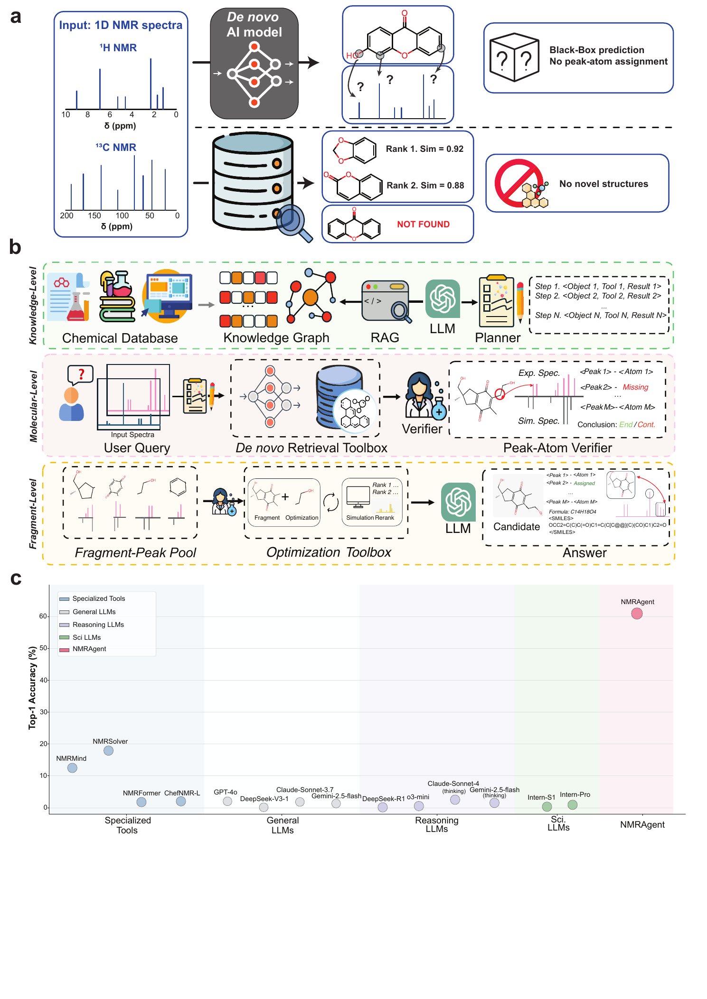

# NMRAgent

Official repository for **Towards Generalizable and Evidential Nuclear Magnetic Resonance-Based Molecular Structure Elucidation via Large Language Model Agent**.

**Paper:** [arXiv:2606.29776](https://arxiv.org/abs/2606.29776)



[PDF version of the overview figure](docs/assets/NMRAgent_BC1.pdf)

NMRAgent uses a LangGraph workflow to infer molecular structures from a molecular formula and NMR shifts. This repository provides the agent, retrieval/de novo/optimization tools, benchmark runners, case inputs, and evaluation scripts. Model checkpoints, retrieval indexes, and full benchmark datasets are external assets.

- [1. Dependencies and installation](#1-dependencies-and-installation)
- [2. Model, data, and LLM configuration](#2-model-data-and-llm-configuration)
- [3. Input format](#3-input-format)
- [4. Benchmark inference](#4-benchmark-inference)
- [5. Case-study inference](#5-case-study-inference)
- [6. Outputs and evaluation](#6-outputs-and-evaluation)
- [7. Optional chat, services, and RAG](#7-optional-chat-services-and-rag)
- [8. Data availability](#8-data-availability)
- [9. Acknowledgements](#9-acknowledgements)
- [10. Citation](#10-citation)

## 1. Dependencies and installation

The full local model runtime targets Linux with an NVIDIA GPU. [environment.yml](environment.yml) specifies the environment:

| Component | Environment specification | Purpose |
| --- | --- | --- |
| Python | 3.11 | Agent, tools, inference, and evaluation |
| PyTorch / CUDA runtime | PyTorch 2.5, CUDA 12.1 | Retrieval, de novo generation, and NMRNet |
| Chemistry and retrieval | RDKit ≥2024.09, FAISS CPU ≥1.8, LMDB ≥1.4 | SMILES processing and indexed structure retrieval |
| Numerical libraries | NumPy ≥1.26 and <2.3, SciPy ≥1.13, pandas ≥2.2, scikit-learn ≥1.4 | Matching, data processing, and model utilities |
| Agent and API | LangGraph 1.x, langchain-core 1.x, OpenAI Python SDK 2.x | Workflow and OpenAI-compatible LLM calls |
| Neural model utilities | Transformers 4.x, Accelerate, tokenizers, safetensors | Checkpoint and tokenizer loading |

Additional dependencies, including `libstdcxx-ng`, PyYAML, msgpack, Flask, requests, tqdm, joblib, and addict, are listed in the environment file. UniCore and UniMol utilities are included under `third_party/` and loaded by the model wrappers.

```bash
git clone https://github.com/Meaw0415/NMRAgent.git
cd NMRAgent
conda env create -f environment.yml
conda activate nmragent
python -m pip install --no-deps -e .
```

Use `environment.yml` for the full model runtime; `requirements.txt` and `setup.py` list the smaller set of core package dependencies. Input validation and evaluation require RDKit but do not call the LLM or load neural checkpoints. Full inference also requires the model/data assets and LLM configuration below. The optional service launchers use `tmux` and `curl`.

Check the installed runtime:

```bash
python -c "import torch, rdkit, faiss, lmdb, openai, langgraph; print('PyTorch:', torch.__version__, 'CUDA available:', torch.cuda.is_available())"
```

## 2. Model, data, and LLM configuration

Copy the configuration templates:

```bash
cp configs/runtime_assets.example.json configs/runtime_assets.local.json
cp configs/multi_agent_api.example.yaml configs/multi_agent_api.local.yaml
```

### Model and data assets

Edit `configs/runtime_assets.local.json` to point to your existing assets. The [example configuration](configs/runtime_assets.example.json) contains all supported path entries.

| Asset configuration | Required for |
| --- | --- |
| `NMR_CKPT_DIR` | Root directory for model checkpoints and associated resources |
| `NMR_SEARCH_CKPT` | Retrieval encoder checkpoint |
| `NMR_RETRIEVAL_LMDB`, `NMR_FAISS_INDEX_PATH` | Retrieval records and FAISS index |
| `NMR_ID_MAP_PATH`, `NMR_FORMULA_MAP_PATH` | Vector-ID-to-record lookup and formula filtering |
| `NMR_GAUSSIAN_FAISS_INDEX_PATH`, `NMR_GAUSSIAN_ID_MAP_PATH` | Gaussian embedding index and ID map when that retrieval mode is used |
| `NMR_DENOVO_CKPT` | De novo generation checkpoint |
| `NMR_NMRNET_DIR` | NMRNet checkpoint directory for reranking and optimization |
| `NMR_CHEMBERTA_PATH` | Local ChemBERTa model/tokenizer resources used by the model tools |
| `NMR_KG_DATA_DIR` | Optional knowledge-graph RAG resources |

The default layout uses `artifacts/checkpoints/`, `artifacts/chemberta/`, and `artifacts/kg/`. Use the LMDB, FAISS index, ID map, and formula map from the same retrieval-library build. Paths in the runtime JSON are resolved relative to the repository root; absolute paths are also accepted. These files are supplied separately from the Python installation. See [Data Availability](#8-data-availability) for dataset sources.

Runtime configuration uses `NMR_RUNTIME_CONFIG` when supplied, then the first existing file among `runtime_assets.local.json`, `runtime_assets.json`, and `runtime_assets.example.json` under `configs/`. Existing environment variables take precedence over values loaded from the JSON.

### LLM configuration

Set an API key in the environment:

```bash
export OPENAI_API_KEY="your-api-key"
```

In `configs/multi_agent_api.local.yaml`, select a model available through your endpoint:

```yaml
openai_compatible:
  backend: openai
  model: gpt-4o
  base_url: https://api.openai.com/v1
  api_key_env: OPENAI_API_KEY
  max_tokens: 4096
  temperature: 0.0
```

The batch runner uses this configuration unless `--model` or `--config` overrides it. The default configuration search order is `multi_agent_api.local.yaml`, `multi_agent_api.yaml`, and `multi_agent_api.example.yaml` under `configs/`; `NMR_MULTI_AGENT_CONFIG` can select another file. Local configuration files are ignored by Git.

## 3. Input format

Benchmarks and case studies use the same input loader. Supply a JSON array, a single JSON object, or JSONL with one object per line.

```json
{
  "idx": "example_1",
  "formula": "C2H6O",
  "h_shifts": [1.2, 1.2, 1.2, 3.6, 3.6],
  "c_shifts": [18.0, 58.0],
  "reference_smiles": "CCO"
}
```

| Field | Meaning |
| --- | --- |
| `idx` | Sample ID, unique within the selected input; the loader also accepts `id` |
| `formula` | Required molecular formula |
| `h_shifts` | ¹H chemical shifts in ppm |
| `c_shifts` | ¹³C chemical shifts in ppm |
| `reference_smiles` | Optional reference structure, used only for evaluation |

At least one of `h_shifts` and `c_shifts` must contain peaks. Shifts can be numerical lists or comma/space-separated strings; `h_shift` and `c_shift` aliases are accepted. Repeated shifts and their multiplicities are preserved. Supply integration-expanded lists when the data use that representation; the loader does not infer missing integrations.

NMRGym-style records are also supported:

```json
{
  "idx": 0,
  "answer": "CCO",
  "extra_info": {
    "formula": "C2H6O",
    "h_shifts": [1.2, 1.2, 1.2, 3.6, 3.6],
    "c_shifts": [18.0, 58.0]
  }
}
```

The reference can also be provided as `answer`, `gt_smiles`, or `smiles`. Only the formula, shifts, and a fixed structure-elucidation instruction are passed to the agent. Dataset prompts, reference structures, and archived candidates are excluded from inference. Each sample starts with a fresh agent memory.

## 4. Benchmark inference

The repository includes small input examples for all three benchmarks:

| Benchmark | Example input | Default full-data path | Inference wrapper |
| --- | --- | --- | --- |
| NMRGym | [nmrgym.json](examples/benchmark_inputs/nmrgym.json) | `artifacts/benchmarks/nmrgym_test.json` | `scripts/infer_nmrgym.sh` |
| nmrshiftdb | [nmrshiftdb.json](examples/benchmark_inputs/nmrshiftdb.json) | `artifacts/benchmarks/nmrshiftdb_test.json` | `scripts/infer_nmrshiftdb.sh` |
| Exp450 | [exp450.json](examples/benchmark_inputs/exp450.json) | `artifacts/benchmarks/exp450.json` | `scripts/infer_exp450.sh` |

Full datasets are separate assets. Place them at the default paths or pass `--input`; the runner preserves the supplied split and does not download or resplit data. The wrappers also accept `NMRGYM_INPUT`, `NMRSHIFTDB_INPUT`, or `EXP450_INPUT` as input-path overrides.

Validate the bundled examples without API calls or model loading:

```bash
for benchmark in nmrgym nmrshiftdb exp450; do
  bash "scripts/infer_${benchmark}.sh" \
    --input "examples/benchmark_inputs/${benchmark}.json" \
    --validate-only \
    --output-dir "results/validate_${benchmark}"
done
```

After configuring the assets and LLM, run the full benchmarks:

```bash
bash scripts/infer_nmrgym.sh \
  --input artifacts/benchmarks/nmrgym_test.json \
  --output-dir results/nmrgym

bash scripts/infer_nmrshiftdb.sh \
  --input artifacts/benchmarks/nmrshiftdb_test.json \
  --output-dir results/nmrshiftdb

bash scripts/infer_exp450.sh \
  --input artifacts/benchmarks/exp450.json \
  --output-dir results/exp450
```

For a small inference run, use an example input and `--limit 1`, with a new output directory. `--start` and `--limit` select a subset; `--max-turns` bounds agent iterations. `--resume` skips IDs already written, including errors, when the selected input and stored records match. To retry an error, use a new output directory.

The generic runner is `python scripts/run_benchmark.py --benchmark nmrgym --input INPUT --output-dir OUTPUT`. It also accepts `--benchmark nmrshiftdb`, `exp450`, and `case_study`.

## 5. Case-study inference

The two supplied case inputs are:

| Case | Formula | Input | Execution trace |
| --- | --- | --- | --- |
| Compound 1 | C20H30O3 | [input.json](examples/case_studies/compound_1/input.json) | [trace.log](examples/case_studies/compound_1/trace.log) |
| Compound 2 | C20H14O8 | [input.json](examples/case_studies/compound_2/input.json) | [trace.log](examples/case_studies/compound_2/trace.log) |

Validate a case before loading models:

```bash
python scripts/run_benchmark.py --benchmark case_study \
  --input examples/case_studies/compound_1/input.json \
  --validate-only --output-dir results/validate_compound_1
```

Run either case with the configured LLM and model assets:

```bash
python scripts/run_benchmark.py --benchmark case_study \
  --input examples/case_studies/compound_1/input.json \
  --output-dir results/compound_1

python scripts/run_benchmark.py --benchmark case_study \
  --input examples/case_studies/compound_2/input.json \
  --output-dir results/compound_2
```

`bash examples/run_demo.sh` runs compound 1 using the configured LLM; it accepts the same extra flags, including `--validate-only` and `--output-dir`. For your own molecule, create an input in the format above and pass its path with `--input`.

The bundled case inputs contain formula and shifts. To compute reference-based metrics for a case, add its reference structure to your input as `reference_smiles` before inference. Unlabeled inputs still produce predictions and run traces; reference-based metrics are `null` when no references are supplied.

## 6. Outputs and evaluation

Both benchmark and case runs write the same output layout:

```text
results/<run>/
  inputs.json
  run_manifest.json
  predictions.jsonl
  summary.json
  cases/sample_000000/
    trace.jsonl
    state.json
```

`inputs.json` records the actual inference tasks. `run_manifest.json` records the selected IDs, model, and workflow information. Each sample's trace records LLM system/user messages, responses, and tool calls/results; `state.json` records the returned state for completed runs. `predictions.jsonl` contains sample IDs, references when available, final predictions, verifier candidates, and errors. The runner also writes evaluation results to `summary.json`.

Recompute metrics from exported predictions without API or neural-model calls:

```bash
python scripts/evaluate_benchmarks.py \
  --predictions results/nmrgym/predictions.jsonl \
  --output results/nmrgym/evaluation.json

python scripts/evaluate_benchmarks.py \
  --predictions results/compound_1/predictions.jsonl \
  --output results/compound_1/evaluation.json
```

The evaluator reads the runner's JSON/JSONL prediction records. A minimal labeled record is:

```json
{
  "idx": "example_1",
  "benchmark": "case_study",
  "gt_smiles": "CCO",
  "pred_smiles": "CCO",
  "verifier_candidates": [{"smiles": "CCO"}]
}
```

| Metric | Definition |
| --- | --- |
| `final_answer_top1_accuracy` | Exact canonical non-isomeric SMILES match after removing stereochemistry; reported as a fraction from 0 to 1 |
| `final_answer_mean_morgan_tanimoto` | Mean structural Morgan–Tanimoto similarity, radius 2, 2,048 bits, without chirality |
| `verifier_candidate_topk_accuracy` | Reference presence in the first 1/5/10 verifier candidates, preserving their stored positions; a separate candidate-list diagnostic |
| `labeled_records` | Number of supplied references used as the evaluation denominator |

Missing, invalid, failed, or unaccepted final predictions count as incorrect with zero final-prediction similarity for labeled cases. Unlabeled records are excluded from reference-based metrics. Duplicate prediction IDs and invalid reference SMILES are rejected. Final-answer Top-1 and verifier candidate Top-k are reported separately.

## 7. Optional chat, services, and RAG

For repeated inference, start persistent retrieval and de novo services:

```bash
bash Service/start_nmr_services_tmux.sh
bash Service/check_nmr_services.sh
```

Their defaults are `http://127.0.0.1:8011` for retrieval and `http://127.0.0.1:8012` for de novo generation. Pass `--use-service-tools` to the benchmark runner to use them; NMRNet reranking and optimization still use local assets. Set `NMR_RETRIEVAL_SERVICE_URL` and `NMR_DENOVO_SERVICE_URL` to use other endpoints.

Interactive entrypoints are:

```bash
python scripts/chat_agent.py
python scripts/chat_agent_web.py --host 127.0.0.1 --port 7860
```

Terminal chat supports `/show`, `/rag`, `/solve`, `/reset`, and `/quit`. `bash Service/start_chat_stack.sh` starts retrieval, de novo, and the web UI together in tmux sessions.

Knowledge-graph and textbook RAG can be enabled with `--kg-rag` and `--textbook-rag` after configuring their assets. Optional web RAG is available in the interactive/single-case interfaces and uses `TAVILY_API_KEY`, `SERPER_API_KEY`, or `BRAVE_SEARCH_API_KEY`.

## 8. Data Availability

Benchmark and database datasets used in this study are publicly available. The source data for the PubChem-NMRNet database are available from Hugging Face at [SimNMR-PubChem](https://huggingface.co/datasets/yqj01/SimNMR-PubChem). The NMRGym dataset is available at [Hugging Face](https://huggingface.co/datasets/meaw0415/NMRGym). The processed nmrshiftdb dataset is available at [Zenodo](https://zenodo.org/records/19142375), and the Exp450 dataset is available at [Zenodo](https://doi.org/10.5281/zenodo.16952024). Detailed information on dataset construction, preprocessing, and benchmark splits is provided in the Supplementary Information.

For construction of the retrieval database, a subset of NMR spectra was simulated from molecular structures using the commercially available Gaussian quantum-chemistry software.

The downstream structural elucidation and structural revision cases were obtained from publicly available literature, including [Altechromone A](https://pubs.acs.org/doi/10.1021/np1005604), [Samoquasine A](https://pubs.acs.org/doi/10.1021/acs.jnatprod.8b00319), the [natural tetrahydroquinoxaline-6-carboxylic acid isolated from *Caulis Sinomenii*](https://pubs.acs.org/doi/10.1021/acs.jnatprod.5c01215), [C5-hydroxy-cyclo(L-Pro-L-Leu)](https://chemrxiv.org/doi/10.26434/chemrxiv-2026-gb0hz), and the [coumarin dimers isolated from *Hydrangea davidii*](https://analyticalsciencejournals.onlinelibrary.wiley.com/doi/10.1002/mrc.70105). The only non-publicly sourced downstream case was the *Vitex trifolia* case, for which experimental NMR data were provided by Peking Union Medical College/Chinese Academy of Medical Sciences (PUMC/CAMS).

## 9. Acknowledgements

We thank our collaborators for helpful discussions on NMR spectroscopy, natural-product structure elucidation, and experimental validation. We gratefully acknowledge funding and institutional support from **The Hong Kong University of Science and Technology (Guangzhou) (HKUST(GZ))**. We also thank Peking Union Medical College/Chinese Academy of Medical Sciences (PUMC/CAMS) for providing experimental NMR data for the *Vitex trifolia* case. We acknowledge the maintainers and contributors of the open-source software and public scientific resources that make NMRAgent possible, including LangGraph, RDKit, FAISS, and the NMR data resources used in this project.

## 10. Citation

If you find NMRAgent useful in your research, please cite our paper:

**Paper:** [Towards Generalizable and Evidential Nuclear Magnetic Resonance-Based Molecular Structure Elucidation via Large Language Model Agent](https://arxiv.org/abs/2606.29776)

```bibtex
@article{fang2026towards,
  title={Towards Generalizable and Evidential Nuclear Magnetic Resonance-Based Molecular Structure Elucidation via Large Language Model Agent},
  author={Fang, Zheng and Yang, Chen and Tan, Yusen and Zhao, Yunpeng and Xu, Fanjie and Xiang, Hongxin and Sun, Hanyu and Gao, Hanyu and Wang, Xiaojian and Du, Wenjie and Li, Yuqiang and Xia, Jun},
  journal={arXiv preprint arXiv:2606.29776},
  year={2026},
  doi={10.48550/arXiv.2606.29776}
}
```
